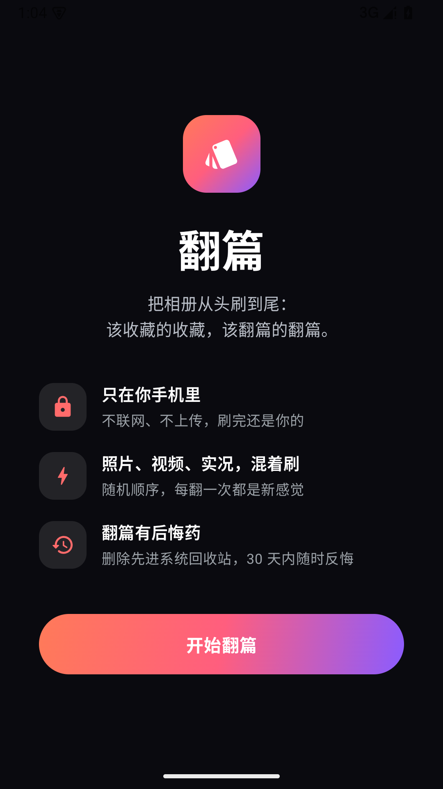
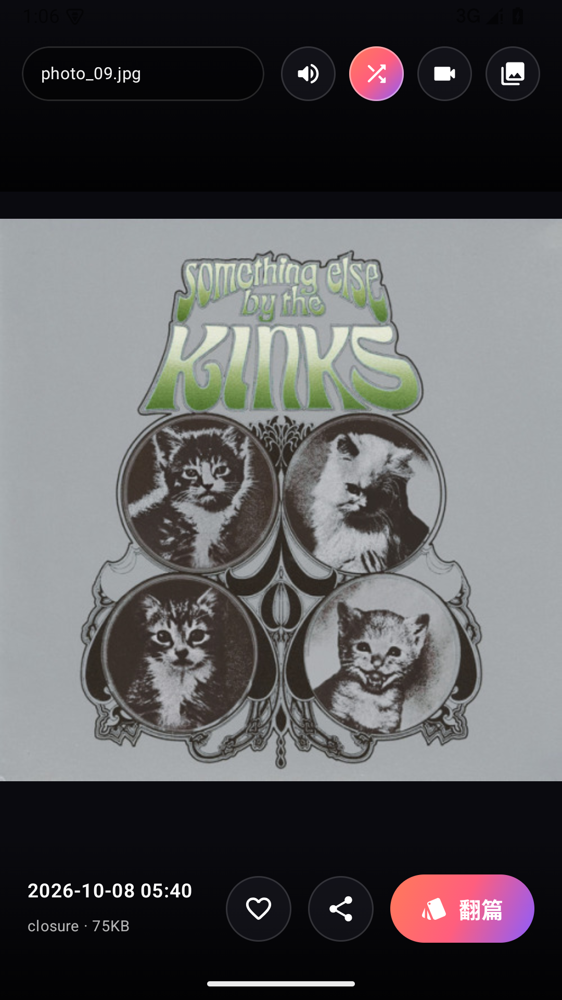
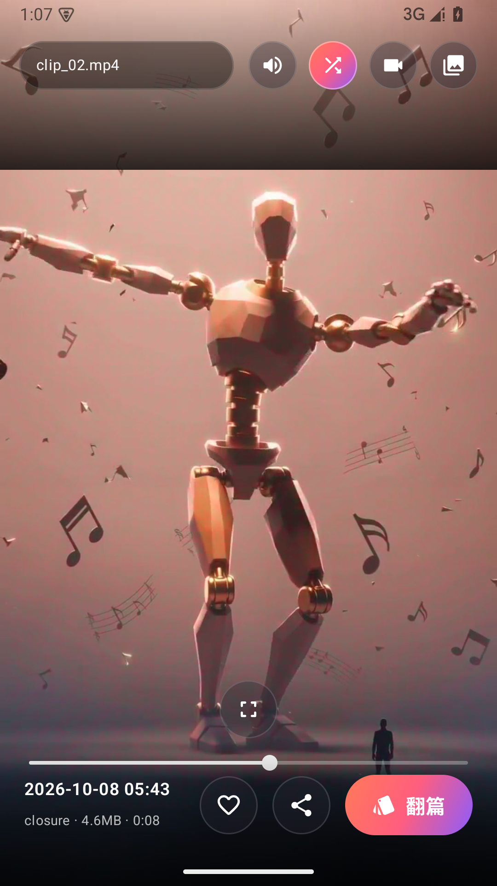
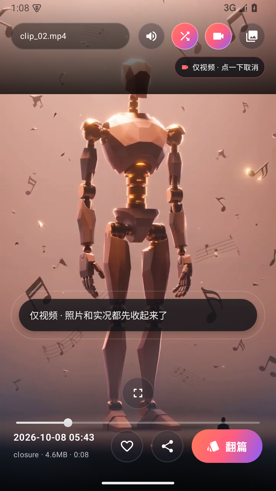
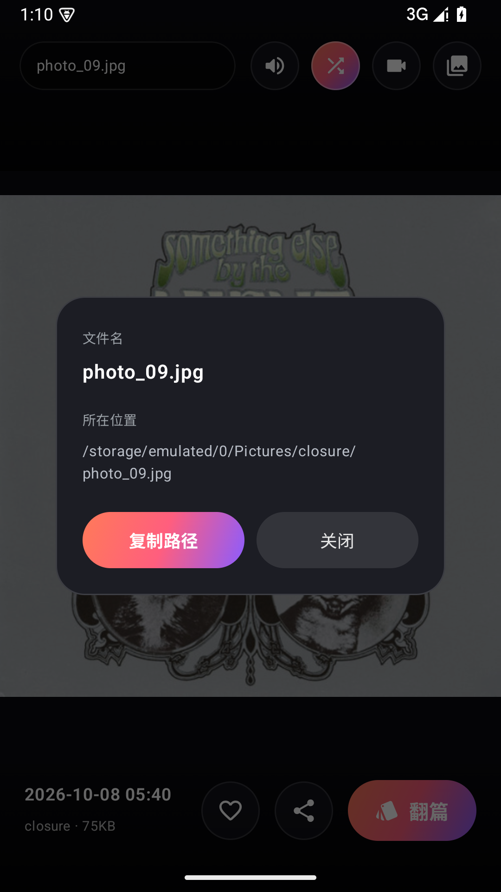
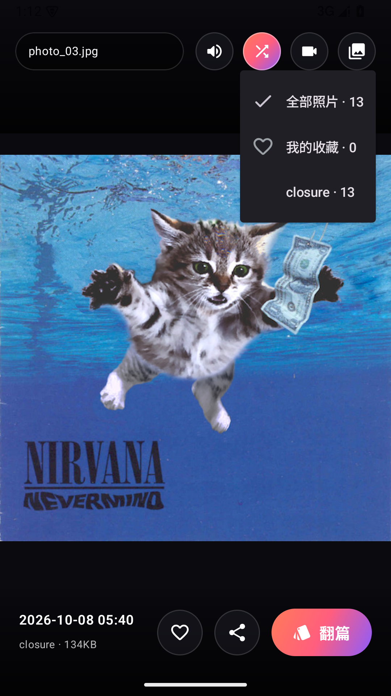
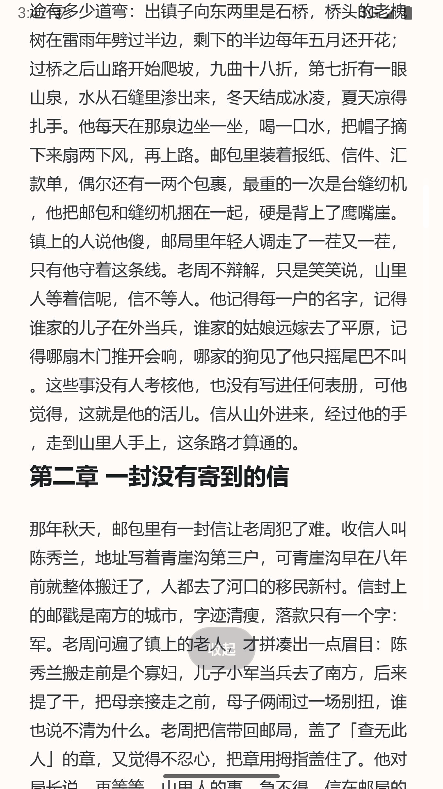
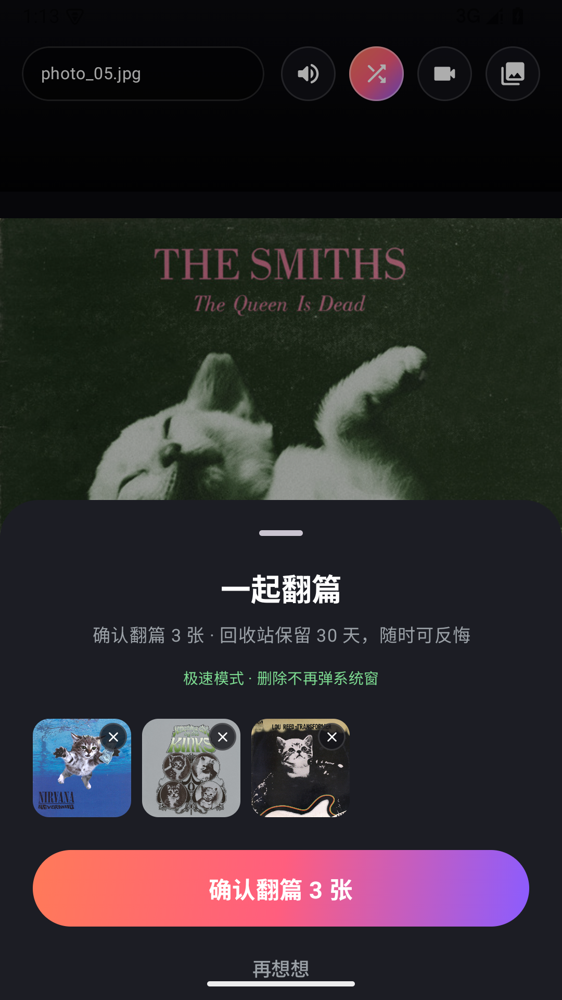

# Closure（翻篇）

像刷短视频一样整理你的相册：全屏竖滑，边刷边决定去留，攒一批、一次翻篇。

> 照片不会消失，只是翻过去的那一页，终于合上了。

## 发心

中文里有个词，叫「翻篇」。

发生的事就让它发生，翻过这一页，日子接着往下过。它不是假装什么都没发生，而是承认这一页已经写完了——不撕掉、不涂改，只是好好合上，然后轻装走接下来的路。英文里，这件事叫 **closure**。

每个人的手机相册，都是堆得最满的那个房间：几千张截图、连拍里挑不出差别的一张、早就结束的关系、某个深夜没忍住的记录。我们舍不得删，是怕忘；可一直留着，它们就一格一格占着心事。

Closure 想做的事很小：找一个不困的晚上，把相册从头刷到尾。像刷短视频一样，一张一张过去，每一张只问一个问题——**翻，还是不翻？** 该收藏的收藏，该翻篇的翻篇。翻过去的先进回收站待满 30 天，随时反悔；留下的，就是你亲手确认过的现在。

它不联网、不上传、没有社交、没有点赞，你的记忆只属于你一个人。

翻篇不是失去，是把这一页好好合上，把位置腾给新的故事。

## 功能特性

- **竖滑刷相册**：照片、视频、实况照片、GIF 混在一起刷，预加载前后各一张
- **随机 / 时间顺序**：顶栏随机按钮切换。默认随机且每次启动都是随机；关掉后按拍摄时间从近到远，和系统相册一致
- **仅视频模式**：顶栏摄像头按钮一键切换，刷流只留视频（可与相册 / 收藏筛选叠加）；再点一下即恢复照片 + 视频混刷
- **翻篇（删除）**：点「翻篇」攒一批，最后一次性系统确认删除；删除内容进系统相册回收站，30 天内可反悔
- **收藏**：心形收藏直接写入系统相册（`MediaStore.IS_FAVORITE`），其他相册 App 也能识别；支持只看收藏
- **实况照片**：识别各厂商 Motion Photo，提取内嵌视频原地播放
- **长图展开**：低清整图垫底 + 按内容坐标分块的瓦片式高清解码，滚动时已解区域保持清晰，任意长度不爆内存
- **视频**：自动播放循环、静音开关、进度条点按 / 拖动定位；全屏按画面真实方向决定横竖（竖拍视频不会被转成横屏）
- **文件名与路径**：顶栏文件名点一下弹出完整文件名和所在目录，可一键复制路径
- **照片手势**：双击沉浸全屏、双指缩放、长图双击展开 / 收起
- **极速翻篇（可选）**：授予「所有文件访问」后删除不再弹系统确认框
- **纯本地**：不联网、不上传，没有任何分析统计

## 截图

| 首屏 | 照片刷流 | 视频刷流 |
| --- | --- | --- |
|  |  |  |

| 仅视频模式 | 文件名与路径 | 相册筛选 |
| --- | --- | --- |
|  |  |  |

| 长图展开（瓦片高清） | 一起翻篇（单张可取消） |
| --- | --- |
|  |  |

## 顶栏按钮

| 图标 | 作用 |
| --- | --- |
| 喇叭 | 静音开关（视频与实况统一生效，记住偏好） |
| 交叉箭头 | 随机 / 时间顺序开关，亮起为随机 |
| 摄像头 | 仅视频模式，亮起为只刷视频 |
| 相册 | 按相册筛选、只看收藏 |
| 文件名 | 点一下看完整文件名与所在路径，可复制 |

## 技术栈

| 项 | 选型 |
| --- | --- |
| 语言 | Kotlin 2.1 |
| UI | Jetpack Compose（Material 3）、VerticalPager |
| 图片 | Coil 2.7（含 GIF、视频首帧解码） |
| 视频 | Media3 ExoPlayer 1.7 |
| 系统 | minSdk 30（Android 11+），target/compile 36 |

## 构建与运行

```bash
git clone https://github.com/nuclear-maker/closure.git
cd closure
./gradlew assembleDebug        # 产物在 app/build/outputs/apk/debug/
```

或直接用 Android Studio（Ladybug 及以上）打开工程，插上手机点 Run。

- 首次启动会先看到介绍页，点「开始翻篇」才会申请照片/视频权限
- Android 14 的「仅允许访问选中的照片」部分授权同样可用
- 极速翻篇需要额外授予「所有文件访问」，不授予也能正常用（走系统确认弹窗）

## 项目结构

```
app/src/main/java/com/closure/
├── MainActivity.kt        # 入口与权限时序（首屏 → 点开始 → 授权）
├── ClosureApp.kt          # 应用级初始化（Coil 解码器注册：GIF/视频帧）
├── data/                  # MediaStore 读取、收藏写入、媒体模型
├── media/                 # Motion Photo 识别与内嵌视频提取
└── ui/
    ├── feed/              # 刷流页（分页、视频播放、长图瓦片、批量删除）
    └── theme/             # 品牌色与主题
```

## 贡献

Issue 与 PR 都欢迎。提交前请跑一遍 `./gradlew assembleDebug` 确保能编译通过。

## 许可证

[MIT](LICENSE)
